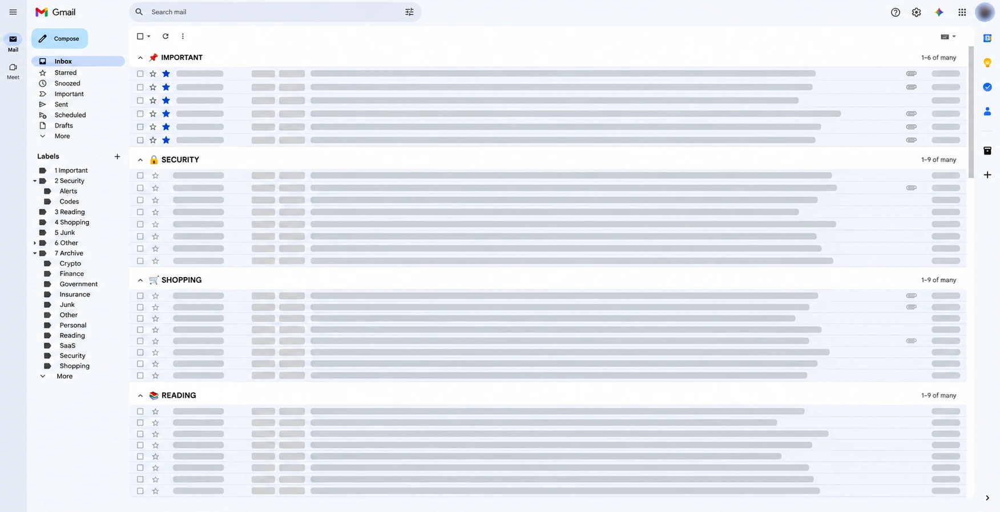
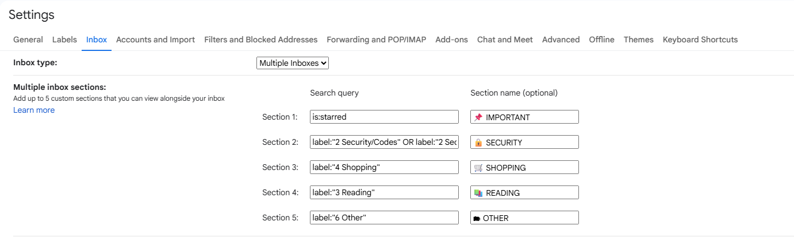

# Gmail Inbox Sorting Skill

A portable **skill for an AI agent** (Claude / ChatGPT / Grok) that sorts a Gmail inbox into
stable categories by explicit rules — separating important mail from marketing, security noise
and receipts, and keeping it that way with filters. Built from a real cleanup that took an
inbox from **~21,000 to ~300** messages.

## What it looks like



*The inbox split into sections above the mailbox (IMPORTANT = starred, SECURITY, SHOPPING, READING, …)
with the full label tree on the left. Message contents are blurred.*

> ⚠️ **Anonymized example.** Specific personal addresses, names and company domains are replaced
> with placeholders (`your-account`, `contact-lawyer`, `your-company`…). When you use it, fill in
> your own sender lists and human whitelist.

## What's in the repo

| File | What it is |
|---|---|
| **[SKILL.md](SKILL.md)** | **The skill** — ready-to-apply rules (label scheme, sender lists, keywords, priority, safety guard). This is what you give the agent. |
| **[BACKGROUND.md](BACKGROUND.md)** | Decisions · open items · TODO (context and state of the reorganization). |
| **[addon/](addon/)** | A Gmail add-on (Google Apps Script) for one-click archiving to `7 Archive/Personal`, plus a deployment guide. |

## How to use it

### A) With an agent that can call the Gmail API (Claude Code / your own script)
1. Put **`SKILL.md`** in the agent's context (optionally also `BACKGROUND.md`).
2. Give it **OAuth access** to the mailbox (a refresh token, scopes `gmail.modify` +
   `gmail.settings.basic`). The token is **not** in this repo — keep it outside it (see `.gitignore`).
3. The agent **first asks two things**: (a) what language most of your mail is in (to localize the
   keyword rules — sender lists are language-independent), and (b) how old mail should be before it's
   archived (6m / 1y / 2y / 3y). Then tell it what you want (audit / sort / "put this email into
   Shopping"). It moves the existing mail per the rules and creates filters for future mail.

### B) As a reference playbook for any agent
Even without API access the skill works as a **precise manual** for how to sort the mailbox
(scheme, rules, priority).

### Label scheme
```
1 Important (= star) · 2 Security (/Codes /Alerts) · 3 Reading · 4 Shopping · 5 Junk
6 Other (/SaaS /Finance /Crypto /Government /Insurance) · 7 Archive (/Personal /Shopping …)
```

### Multiple Inboxes setup (the view above the inbox)

Gmail → ⚙ → See all settings → **Inbox** tab → **Inbox type: Multiple Inboxes** → fill the sections
(up to 5), then **Save Changes**:



| # | Search query | Section name |
|---|---|---|
| 1 | `is:starred` | ⭐ IMPORTANT |
| 2 | `label:"2 Security/Codes" OR label:"2 Security/Alerts" OR label:"2 Security"` | 🔒 SECURITY |
| 3 | `label:"4 Shopping"` | 🛒 SHOPPING |
| 4 | `label:"3 Reading"` | 📚 READING |
| 5 | `label:"6 Other"` | 🗂 OTHER |

The main inbox underneath = everything not filed elsewhere. **IMPORTANT = `is:starred`** (star the mail
you care about). Note: `label:"2 Security"` alone does **not** include its sub-labels — list them with `OR`.
Junk doesn't need a section (it's filed away by filters).

## Safety principles (built into the skill)

- **Measure → show a sample → move** (for large batches).
- "Delete" = **Trash** (reversible 30 days), never a hard delete.
- **Safety guard:** urgent mail (overdue / due / failed payment) stays in the inbox.
- **Never touch** a critical accounting-forward filter, if one exists.
- **No tokens in the repo.** `.env*` is in `.gitignore`.

## Gmail add-on (optional)

`addon/` contains a small Apps Script add-on that adds a button **📁 → 7 Archive/Personal**
(one-click archive). Deployment: `addon/DEPLOYMENT.md`. Note: the add-on lives in Gmail's side
panel (not the top toolbar) and does not close the open email after the action — a limitation of
Apps Script add-ons.

## Limitations / status

- Priority (dual-label) dedup is one-off — new mail can get a double label again; re-run the
  dedup periodically or use mutually-exclusive Multiple Inboxes section queries.
- Sender lists grow as the user flags mail (every flag becomes a new rule).

---
*Personal tool. The rules are tailored to one specific mailbox; for another mailbox, swap in your
own sender lists and whitelist.*
